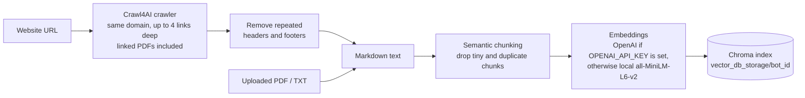
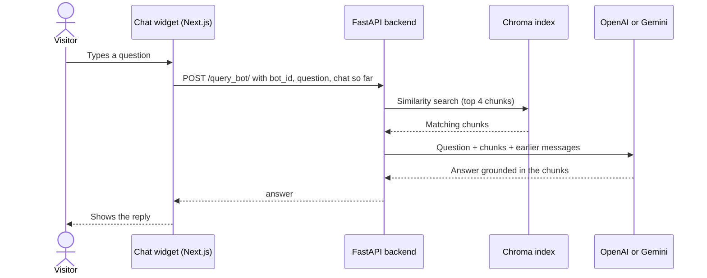

<div align="center">


# Prompt

**Train, embed, engage.** Turn a website or a stack of documents into a chat assistant that answers questions about them.


[Demo video](https://drive.google.com/file/d/19qSNNAgS8VqP1Hc_1m-gkJfs04GG7CvV/view?usp=sharing) · [Quick start](#quick-start) · [How it works](#how-it-works) · [API](#api)

</div>

---

## What it does

You give Prompt a website address, some PDF or text files, or both. It reads everything, breaks it into small pieces and stores them in a searchable index. When someone asks a question, it finds the most relevant pieces and has an LLM (OpenAI or Google Gemini, using your own API key) write the answer from them.

The aim is a support or FAQ bot for your site that you can set up without writing code.

| Step | Page | What you do |
| --- | --- | --- |
| 1. Train | `/train` | Paste a URL and/or upload `.pdf` / `.txt` files, add your model API key, and create the bot. |
| 2. Customise | `/playground` | Set the bot's name, welcome message, colours and avatar, then chat with it in a live preview. |
| 3. Embed | `/train` | Copy the `<script>` tag for your site. *(Work in progress, see [Status](#status).)* |

## How it works

### Building the knowledge base



Each bot gets its own ID (a UUID) and its own folder on disk, so you can train several bots side by side.

### Answering a question



If no stored key or chosen model is passed in, the backend falls back to `gpt-4o-mini` using the server's `OPENAI_API_KEY`.

## Quick start

You need **Docker** for the backend and **Node.js 18+** for the frontend.

### 1. Clone

```bash
git clone https://github.com/myameen123/Prompt-No-Code-Website-Assistant-Builder.git
cd Prompt-No-Code-Website-Assistant-Builder
```

### 2. Create a `.env` file

Put it in the project root. Docker Compose expects it to exist.

```env
# Used for embeddings and as the fallback chat model.
# Leave it out to use free local embeddings instead (answers then need a key added in the UI).
OPENAI_API_KEY=sk-...
```

### 3. Start the backend

```bash
docker compose -f docker-compose.dev.yml up --build -d   # hot reload, CORS open to all origins
# or
docker compose up --build -d                             # production settings
```

On Windows you can run `.\start-local.ps1` instead; it asks which mode you want. Check it is up at <http://localhost:8000/health>, and browse the API at <http://localhost:8000/docs>.

### 4. Start the frontend

```bash
cd prompt-frontend
npm install
echo "NEXT_PUBLIC_BACKEND_URL=http://localhost:8000" > .env.local
npm run dev
```

Open <http://localhost:3000>, go to **Train**, and create your first bot.

<details>
<summary><b>Running the backend without Docker</b></summary>

```bash
python -m venv .venv
source .venv/bin/activate          # Windows: .venv\Scripts\activate
pip install -r requirements.txt
playwright install chromium        # the crawler drives a headless browser
uvicorn app:app --reload --port 8000
```

Set `ENVIRONMENT=development` to allow requests from any origin while developing.

</details>

## Configuration

| Variable | Where | Purpose |
| --- | --- | --- |
| `OPENAI_API_KEY` | `.env` (backend) | Embeddings and the fallback chat model. Optional. |
| `ENVIRONMENT` | backend | Set to `development` to allow CORS from any origin. |
| `NEXT_PUBLIC_BACKEND_URL` | `prompt-frontend/.env.local` | Where the frontend sends API calls. Default `http://localhost:8000`. |
| `NEXT_PUBLIC_FRONTEND_URL` | `prompt-frontend/.env.local` | Base URL used when generating the embed script. Default `http://localhost:3000`. |

To allow a deployed frontend in production, add its URL to the `origins` list in [`app.py`](app.py).

## API

| Method | Endpoint | Body | Returns |
| --- | --- | --- | --- |
| `POST` | `/create_bot/` | form data: `website_url` and/or `files[]` | `{ bot_id }` |
| `POST` | `/query_bot/` | JSON: `bot_id`, `query`, `context`, optional `model` or `user_id` | `{ answer }` |
| `POST` | `/store_api_key/` | JSON: `user_id`, `provider`, `api_key`, `model_name` | message |
| `GET` | `/get_user_models/{user_id}` | | saved providers and models |
| `DELETE` | `/delete_api_key/` | JSON: `user_id`, `provider` | message |
| `GET` | `/health` | | `{ status: "healthy" }` |

Interactive docs are at `/docs` while the backend is running.

## Project layout

```text
.
├── app.py                  FastAPI app and all endpoints
├── document_loader.py      loading, chunking, embeddings, Chroma
├── main_gradio.py          prompt building and the LLM call (formulate_answer)
├── crawler/                Crawl4AI website crawler
├── text_postprocessing/    header/footer removal, page tree to markdown
├── user_api_storage.py     per-user API key store (JSON file)
├── Dockerfile.backend
├── docker-compose.yml      production settings
├── docker-compose.dev.yml  hot reload, source mounted
└── prompt-frontend/        Next.js 15 app (Tailwind, Radix UI)
    └── app/
        ├── page.js         landing page
        ├── train/          create a bot, manage API keys, get the embed script
        └── playground/     customise and test the chat widget
```

## Status

This started as a team project and is still growing. Here is where things stand.

### Works today

- Training from a website, PDF and TXT files, or both
- OpenAI and Gemini models with your own API key
- The Playground chat preview with custom styling
- Docker setup with health checks

### Not done yet

- **Embed script.** `/api/chatbot/[bot_id]` currently returns a placeholder, not the real chat widget.
- **Key storage.** API keys are saved as plain text in `user_api_keys.json` and in the browser's `localStorage`. Don't use production keys on a shared server.
- **Users.** There are no accounts; a random user ID lives in the browser.
- **CORS.** The `https://*.vercel.app` entry in `app.py` does not match as a wildcard. List your exact frontend URL there instead.
- **File types.** Only `.pdf` and `.txt` are accepted for upload.

Pull requests for any of these are very welcome.

## Contributing

1. Fork the repo and create a branch: `git checkout -b feature/short-name`
2. Make your change and test it against a locally running backend and frontend
3. Open a pull request that explains what changed and why

## Credits

Built by **Team Chateaus**. See everyone who helped on the [contributors page](https://github.com/myameen123/Prompt-No-Code-Website-Assistant-Builder/graphs/contributors).
